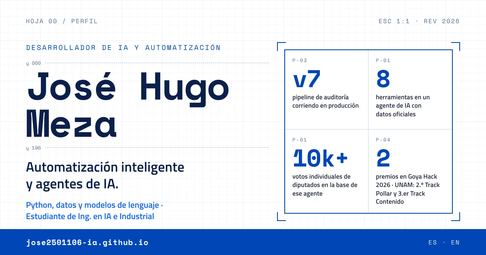
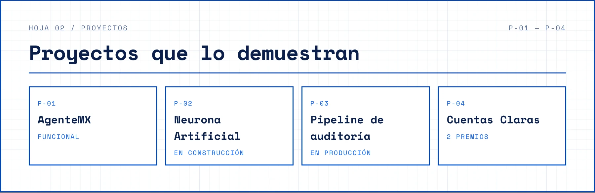
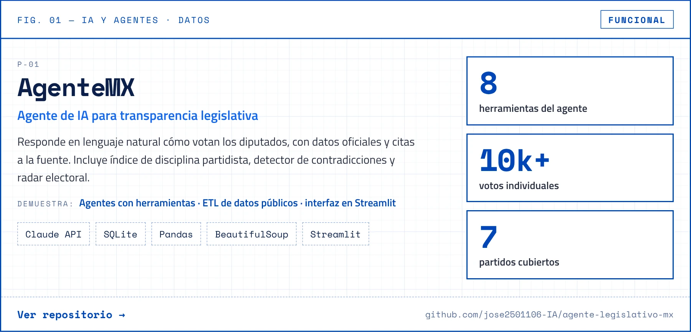
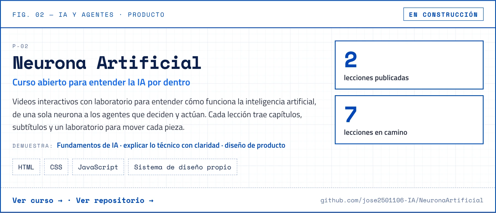
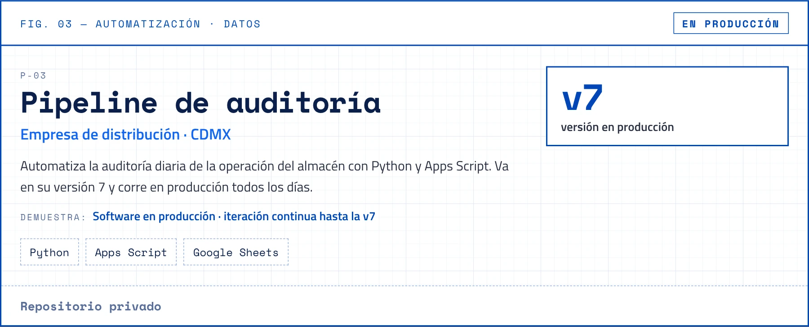
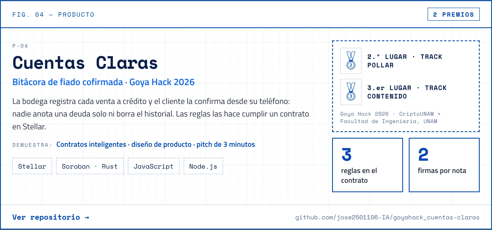
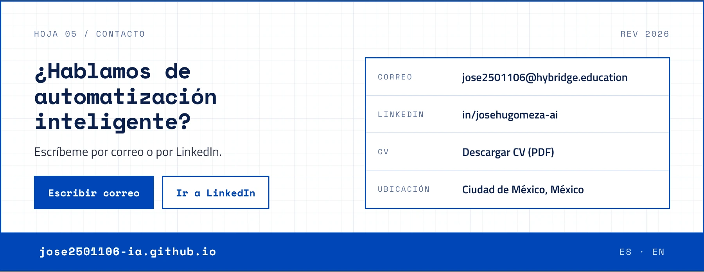

<!-- Generado por scripts/generar_readme.py desde data/perfil.yml del portafolio. No lo edites a mano: cambia perfil.yml y vuelve a generar. -->

<a href="https://jose2501106-ia.github.io/">
<picture>
  <source media="(prefers-color-scheme: dark)" srcset="assets/laminas/encabezado-oscuro.webp">
  
</picture>
</a>

  <a href="https://jose2501106-ia.github.io/"><b>Portafolio</b></a> ·
  <a href="https://jose2501106-ia.github.io/en/">English</a> ·
  <a href="https://www.linkedin.com/in/josehugomeza-ai/">LinkedIn</a> ·
  <a href="https://jose2501106-ia.github.io/cv/jose-hugo-meza-cv-es.pdf">CV (PDF)</a> ·
  <a href="mailto:jose2501106@hybridge.education">jose2501106@hybridge.education</a> ·
  Ciudad de México, México

Entré a una empresa de distribución como auxiliar administrativo y a los tres meses quedé al frente de su bodega. Hoy, como desarrollador independiente, la apoyo con automatizaciones que se usan todos los días y desarrollo sus primeras soluciones de IA, mientras estudio dos ingenierías: Inteligencia Artificial e Industrial.

<picture>
  <source media="(prefers-color-scheme: dark)" srcset="assets/laminas/roles-oscuro.webp">
  
</picture>

<picture>
  <source media="(prefers-color-scheme: dark)" srcset="assets/laminas/proyectos-oscuro.webp">
  
</picture>

<a href="https://github.com/jose2501106-IA/agente-legislativo-mx">
<picture>
  <source media="(prefers-color-scheme: dark)" srcset="assets/laminas/p-01-oscuro.webp">
  
</picture>
</a>

<a href="https://github.com/jose2501106-IA/agente-legislativo-mx">P-01 · Ver repositorio →</a>

<a href="https://jose2501106-ia.github.io/NeuronaArtificial/">
<picture>
  <source media="(prefers-color-scheme: dark)" srcset="assets/laminas/p-02-oscuro.webp">
  
</picture>
</a>

<a href="https://jose2501106-ia.github.io/NeuronaArtificial/">P-02 · Ver curso →</a> · <a href="https://github.com/jose2501106-IA/NeuronaArtificial">P-02 · Ver repositorio →</a>

<picture>
  <source media="(prefers-color-scheme: dark)" srcset="assets/laminas/p-03-oscuro.webp">
  
</picture>

P-03 · Repositorio privado

<a href="https://github.com/jose2501106-IA/goyahack_cuentas-claras">
<picture>
  <source media="(prefers-color-scheme: dark)" srcset="assets/laminas/p-04-oscuro.webp">
  
</picture>
</a>

<a href="https://github.com/jose2501106-IA/goyahack_cuentas-claras">P-04 · Ver repositorio →</a>

<picture>
  <source media="(prefers-color-scheme: dark)" srcset="assets/laminas/herramientas-oscuro.webp">
  
</picture>

<picture>
  <source media="(prefers-color-scheme: dark)" srcset="assets/laminas/formacion-oscuro.webp">
  
</picture>

<a href="https://app.aluracursos.com/immersion/certificate/00c74f55-f2d9-4ec7-990c-bcddc214aaa0">Oracle Next Education · Verificar autenticidad →</a>

<a href="https://jose2501106-ia.github.io/#contacto">
<picture>
  <source media="(prefers-color-scheme: dark)" srcset="assets/laminas/contacto-oscuro.webp">
  
</picture>
</a>

  <a href="mailto:jose2501106@hybridge.education"><b>jose2501106@hybridge.education</b></a> ·
  <a href="https://www.linkedin.com/in/josehugomeza-ai/">in/josehugomeza-ai</a> ·
  <a href="https://jose2501106-ia.github.io/cv/jose-hugo-meza-cv-es.pdf">Descargar CV (PDF)</a> ·
  <a href="https://jose2501106-ia.github.io/">Portafolio</a>

 

<picture>
  <source media="(prefers-color-scheme: dark)" srcset="https://raw.githubusercontent.com/jose2501106-IA/jose2501106-IA/output/github-snake-dark.svg">
  
</picture>

<i>“Ingeniero industrial en formación, developer por curiosidad, operador por necesidad.”</i>

Este README se genera desde <code>perfil.yml</code>, la misma fuente que usa el portafolio.

