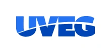
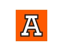
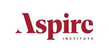
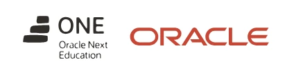
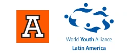
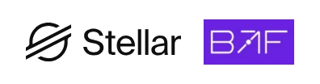

<!-- Generado por scripts/generar_readme.py desde data/perfil.yml del portafolio. No lo edites a mano: cambia perfil.yml y vuelve a generar. -->

  DESARROLLADOR DE IA Y AUTOMATIZACIÓN 
  <b>IA aplicada a datos públicos y transparencia legislativa.</b> 
  Python, datos y modelos de lenguaje · Estudiante de Ing. en IA e Industrial

  <a href="https://jose2501106-ia.github.io/"><b>Portafolio</b></a> ·
  <a href="https://jose2501106-ia.github.io/en/">English</a> ·
  <a href="https://www.linkedin.com/in/josehugomeza-ai/">LinkedIn</a> ·
  <a href="https://jose2501106-ia.github.io/cv/jose-hugo-meza-cv-es.pdf">CV (PDF)</a> ·
  <a href="mailto:jose2501106@hybridge.education">jose2501106@hybridge.education</a> ·
  Ciudad de México, México

Entré a una empresa de distribución como auxiliar administrativo y a los tres meses quedé al frente de su bodega. Hoy, como desarrollador independiente, la apoyo con automatizaciones que se usan todos los días y desarrollo sus primeras soluciones de IA, mientras estudio dos ingenierías: Inteligencia Artificial e Industrial.

<table>
<tr><th scope="row" align="right" valign="top">v7</th><td valign="top" width="100%">pipeline de auditoría corriendo en producción <code>P-03</code> · Fuente: Empresa de distribución</td></tr>
<tr><th scope="row" align="right" valign="top">8</th><td valign="top" width="100%">herramientas en un agente de IA con datos oficiales <code>P-01</code> · Fuente: <a href="https://github.com/jose2501106-IA/agente-legislativo-mx">Repositorio de AgenteMX</a></td></tr>
<tr><th scope="row" align="right" valign="top">10k+</th><td valign="top" width="100%">votos individuales de diputados en la base de ese agente <code>P-01</code> · Fuente: SITL, Cámara de Diputados</td></tr>
<tr><th scope="row" align="right" valign="top">2</th><td valign="top" width="100%">premios en Goya Hack 2026 · UNAM: 2.º Track Pollar y 3.er Track Contenido <code>P-04</code> · Fuente: Goya Hack 2026</td></tr>
</table>

## 1.er lugar en equipo · Laboratorio de Futuros: Chilangatón 2026

OCT 2026 · CDMX · COYOACÁN

**En equipo con La Chilangonería del futuro.** La propuesta del equipo: movilidad para la CDMX y su zona metropolitana al 2040, con lente de cuidados y periferias.

<table>
<tr><th scope="row" align="left" valign="top" width="34%">Metodología de estudios de futuros · la aprendí de mis compañeras especialistas</th><td valign="top"><b>34 fuerzas de cambio</b> · con fuente · STEEP <b>Matriz</b> · impacto × incertidumbre <b>3 escenarios al 2040</b> · Colapso · Inercial · Transformación <b>11 metas</b> · medibles</td></tr>
<tr><th scope="row" align="left" valign="top">Mi rol</th><td valign="top">Análisis de datos e investigación</td></tr>
<tr><th scope="row" align="left" valign="top">Lo que más me llevo</th><td valign="top">Trabajo en equipo, confianza y comunicación</td></tr>
<tr><th scope="row" align="left" valign="top">Fecha</th><td valign="top">25 de octubre de 2026</td></tr>
</table>

Investigación con apoyo de IA (Claude); cada cifra con fuente y revisión humana. · <a href="https://luma.com/j55anly0">Laboratorio de Futuros · Chilangatón 2026 · Ver convocatoria →</a>

## Lo que hago, con evidencia

<table>
<tr><th scope="row" align="left" valign="top" width="30%"><code>R-05</code> Investigación con datos públicos</th><td valign="top">Reúno, limpio y analizo información pública, sobre todo votaciones nominales de la Cámara de Diputados, y la presento con su fuente. En el Laboratorio de Futuros de Chilangatón 2026 mi equipo obtuvo el primer lugar; mi rol fue el análisis de datos y la investigación, con apoyo de IA (Claude) y revisión humana de cada cifra. EVIDENCIA: <code>P-01</code> · <a href="https://jose2501106-ia.github.io/#chilangaton">Chilangatón 2026</a></td></tr>
<tr><th scope="row" align="left" valign="top" width="30%"><code>R-01</code> IA y agentes</th><td valign="top">Agentes con herramientas e integración de modelos de lenguaje (Claude API), del prototipo a la herramienta funcional. EVIDENCIA: <code>P-01</code> <code>P-02</code> </td></tr>
<tr><th scope="row" align="left" valign="top" width="30%"><code>R-02</code> Automatización de procesos</th><td valign="top">Automatizo procesos operativos con Python y Apps Script, de la captura de datos a la auditoría diaria. EVIDENCIA: <code>P-03</code> </td></tr>
<tr><th scope="row" align="left" valign="top" width="30%"><code>R-03</code> Mejora continua / Lean</th><td valign="top">Auditoría diaria de la operación del almacén, mejorada versión tras versión hasta la v7; formación en Lean Management (Lean Six Sigma Institute). EVIDENCIA: <code>P-03</code> </td></tr>
<tr><th scope="row" align="left" valign="top" width="30%"><code>R-04</code> Análisis de datos</th><td valign="top">Limpieza y análisis con Pandas, y tableros para decidir con números. EVIDENCIA: <code>P-01</code> <code>P-03</code> </td></tr>
</table>

<code>// Cómo trabajo: diagnóstico → diseño → construcción con IA y pruebas en 3 capas → control con DMAIC.</code>

## Proyectos que lo demuestran

<table>
<tr>
<td valign="top" width="46%"><code>P-01</code> · IA Y AGENTES · DATOS <b>AgenteMX</b> Agente de IA para transparencia legislativa <a href="https://github.com/jose2501106-IA/agente-legislativo-mx">Ver repositorio →</a></td>
<td valign="top"><b>FUNCIONAL</b> <b>8</b> herramientas del agente <b>10k+</b> votos individuales <b>7</b> partidos cubiertos <code>Claude API</code> <code>SQLite</code> <code>Pandas</code> <code>BeautifulSoup</code> <code>Streamlit</code></td>
</tr>
<tr>
<td valign="top" width="46%"><code>P-02</code> · IA Y AGENTES · PRODUCTO <b>Neurona Artificial</b> Curso abierto para entender la IA por dentro <a href="https://jose2501106-ia.github.io/NeuronaArtificial/">Ver curso →</a> · <a href="https://github.com/jose2501106-IA/NeuronaArtificial">Ver repositorio →</a></td>
<td valign="top"><b>EN CONSTRUCCIÓN</b> <b>2</b> lecciones publicadas <b>7</b> lecciones en camino <code>HTML</code> <code>CSS</code> <code>JavaScript</code> <code>sistema de diseño propio</code></td>
</tr>
<tr>
<td valign="top" width="46%"><code>P-03</code> · AUTOMATIZACIÓN · DATOS <b>Pipeline de auditoría</b> Empresa de distribución · CDMX Repositorio privado</td>
<td valign="top"><b>EN PRODUCCIÓN</b> <b>v7</b> versión en producción <code>Python</code> <code>Apps Script</code> <code>Google Sheets</code></td>
</tr>
<tr>
<td valign="top" width="46%"><code>P-04</code> · PRODUCTO <b>Cuentas Claras</b> Bitácora de fiado cofirmada · Goya Hack 2026 <a href="https://github.com/jose2501106-IA/goyahack_cuentas-claras">Ver repositorio →</a></td>
<td valign="top"><b>2 PREMIOS</b> 2.º LUGAR · TRACK POLLAR 3.er LUGAR · TRACK CONTENIDO <code>Stellar</code> <code>Soroban · Rust</code> <code>JavaScript</code> <code>Node.js</code></td>
</tr>
</table>

<a href="https://jose2501106-ia.github.io/#proyectos">Ver en el portafolio →</a>

## Herramientas

Programación · IA y datos · Automatización · Cloud y hardware · Procesos · Idiomas · Habilidades blandas

 

<table>
<tr><th scope="row" align="left" valign="top" width="26%">Programación</th><td><code>Python</code> <code>JavaScript</code> <code>TypeScript</code> <code>SQL</code> <code>Bash</code></td></tr>
<tr><th scope="row" align="left" valign="top" width="26%">IA y datos</th><td><code>Claude API</code> <code>Claude Code</code> <code>OpenAI</code> <code>Pandas</code> <code>NumPy</code> <code>Streamlit</code></td></tr>
<tr><th scope="row" align="left" valign="top" width="26%">Automatización</th><td><code>Apps Script</code> <code>Google Workspace</code> <code>Excel avanzado</code> <code>GitHub Actions</code></td></tr>
<tr><th scope="row" align="left" valign="top" width="26%">Cloud y hardware</th><td><code>AWS</code> <code>Docker</code> <code>Linux</code> <code>Arduino</code></td></tr>
<tr><th scope="row" align="left" valign="top" width="26%">Procesos</th><td><code>Lean Six Sigma</code> <code>DMAIC</code></td></tr>
<tr><th scope="row" align="left" valign="top">Idiomas</th><td>Español · nativo Inglés · A2, en formación (beca Bécalos)</td></tr>
<tr><th scope="row" align="left" valign="top">Habilidades blandas</th><td>Comunicación: dos certámenes de oratoria (2026), uno de ellos nacional. Liderazgo: Aspire Leaders Program y Emerging Leaders Conference 2026. Ritmo de operación real: decisiones diarias en un negocio con clientes y proveedores.</td></tr>
</table>

## Formación y programas

&nbsp; &nbsp; &nbsp; &nbsp; &nbsp; 

Ver los 6 programas

 

<table>
<tr><th scope="row" align="left" valign="top" width="36%">Hybridge Education</th><td valign="top">Ingeniería en Inteligencia Artificial 4.º cuatrimestre de 8</td></tr>
<tr><th scope="row" align="left" valign="top" width="36%">UVEG · Universidad Virtual del Estado de Guanajuato</th><td valign="top">Ingeniería Industrial 38% completado</td></tr>
<tr><th scope="row" align="left" valign="top" width="36%">Universidad Anáhuac México Norte</th><td valign="top">Seminario de IA y Ciencia de Datos Beca 100% · Santander 2026</td></tr>
<tr><th scope="row" align="left" valign="top" width="36%">Aspire Leaders Program</th><td valign="top">Programa de liderazgo global fundado por académicos de Harvard Seleccionado</td></tr>
<tr><th scope="row" align="left" valign="top" width="36%">Oracle Next Education</th><td valign="top">ONE AI For Business <b>Inmersión: Agentes de IA para Negocios</b> · Finalizada · 13 oct 2026 · <a href="https://app.aluracursos.com/immersion/certificate/00c74f55-f2d9-4ec7-990c-bcddc214aaa0">Verificar autenticidad →</a> <b>Fase Tech Builder</b> · En curso · desde oct 2026</td></tr>
<tr><th scope="row" align="left" valign="top" width="36%">Lean Six Sigma Institute</th><td valign="top">Lean Management En curso · avalado por The Council for Six Sigma Certification</td></tr>
</table>

## Liderazgo, oratoria y comunidad

&nbsp; &nbsp; &nbsp; 

Ver los 5 registros

 

<table>
<tr><th scope="row" align="left" valign="top" width="36%">II Certamen de Oratoria “Ricardo Flores Magón 2026”</th><td valign="top">Realizado en el Senado de la República Reconocimiento por destacada participación · 24 de febrero de 2026 <a href="https://jose2501106-ia.github.io/reconocimientos/2026-02-24_certamen-oratoria-ricardo-flores-magon.pdf">Ver reconocimiento (PDF) →</a></td></tr>
<tr><th scope="row" align="left" valign="top" width="36%">Congreso del Estado de Oaxaca</th><td valign="top">XXIV Certamen Nacional de Oratoria “Licenciado Benito Juárez García 2026” Reconocimiento por destacada participación · 27 de marzo de 2026 <a href="https://jose2501106-ia.github.io/reconocimientos/2026-03-27_certamen-nacional-oratoria-benito-juarez.pdf">Ver reconocimiento (PDF) →</a></td></tr>
<tr><th scope="row" align="left" valign="top" width="36%">Universidad Anáhuac México · World Youth Alliance</th><td valign="top">Emerging Leaders Conference 2026: “Educación en dignidad humana e identidad personal” Reconocimiento por participación · 23 y 24 de septiembre de 2026 <a href="https://jose2501106-ia.github.io/reconocimientos/2026-09-23_emerging-leaders-conference.pdf">Ver reconocimiento (PDF) →</a></td></tr>
<tr><th scope="row" align="left" valign="top" width="36%">Universidad Anáhuac México · Human &amp; Nonhuman Communication Lab</th><td valign="top">Primer Hackathon de Vibe Coding de la Anáhuac: “El Lenguaje es el nuevo código: Prompting Good Hackathon de AI for Good” Reconocimiento como asistente · 17 de abril de 2026 <a href="https://jose2501106-ia.github.io/reconocimientos/2026-04-17_hackathon-vibe-coding-anahuac.pdf">Ver reconocimiento (PDF) →</a></td></tr>
<tr><th scope="row" align="left" valign="top" width="36%">Programa de Embajadores de Stellar</th><td valign="top">Embajador en Latinoamérica · coordinado por BAF Desde octubre de 2026</td></tr>
</table>

<a href="https://jose2501106-ia.github.io/#perfil">Ver en el portafolio →</a>

## ¿Hablamos de IA aplicada al sector público?

Busco prácticas profesionales en IA aplicada al sector público, en modalidad mixta (presencial y remota). Escríbeme por correo o por LinkedIn.

<b>CORREO</b> · <a href="mailto:jose2501106@hybridge.education">jose2501106@hybridge.education</a> 
<b>LINKEDIN</b> · <a href="https://www.linkedin.com/in/josehugomeza-ai/">in/josehugomeza-ai</a> 
<b>CV</b> · <a href="https://jose2501106-ia.github.io/cv/jose-hugo-meza-cv-es.pdf">Descargar CV (PDF)</a> 
<b>PORTAFOLIO</b> · <a href="https://jose2501106-ia.github.io/#contacto">jose2501106-ia.github.io</a> 
<b>UBICACIÓN</b> · Ciudad de México, México

<i>“Ingeniero industrial en formación, developer por curiosidad, operador por necesidad.”</i>

Este README se genera desde <code>perfil.yml</code>, la misma fuente que usa el portafolio.

