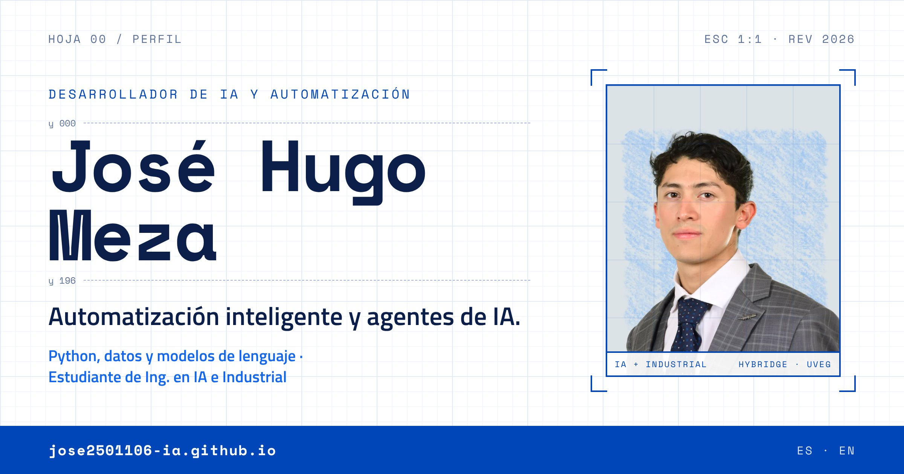

<!-- Generado por scripts/generar_readme.py desde data/perfil.yml del portafolio. No lo edites a mano: cambia perfil.yml y vuelve a generar. -->

<a href="https://jose2501106-ia.github.io/">
  <picture>
    <source media="(prefers-color-scheme: dark)" srcset="assets/banner-oscuro.jpg">
    
  </picture>
</a>

  <a href="https://jose2501106-ia.github.io/"><b>Portafolio</b></a> ·
  <a href="https://jose2501106-ia.github.io/en/">English</a> ·
  <a href="https://www.linkedin.com/in/josehugomeza-ai/">LinkedIn</a> ·
  <a href="mailto:jose2501106@hybridge.education">jose2501106@hybridge.education</a> ·
  Ciudad de México, México

Entré a una empresa de distribución como auxiliar administrativo y a los tres meses quedé al frente de su bodega. Hoy, como desarrollador independiente, la apoyo con automatizaciones que se usan todos los días y desarrollo sus primeras soluciones de IA, mientras estudio dos ingenierías: Inteligencia Artificial e Industrial.

## Lo que hago, con evidencia

- **IA y agentes.** Agentes con herramientas e integración de modelos de lenguaje (Claude API), del prototipo a la herramienta funcional. EVIDENCIA: [P-01](#p-01--agentemx) · [P-02](#p-02--neurona-artificial)
- **Automatización de procesos.** Automatizo procesos operativos con Python y Apps Script, de la captura de datos a la auditoría diaria. EVIDENCIA: [P-03](#p-03--pipeline-de-auditoría)
- **Mejora continua / Lean.** Auditoría diaria de la operación del almacén, mejorada versión tras versión hasta la v7; formación en Lean Management (Lean Six Sigma Institute). EVIDENCIA: [P-03](#p-03--pipeline-de-auditoría)
- **Análisis de datos.** Limpieza y análisis con Pandas, y tableros para decidir con números. EVIDENCIA: [P-01](#p-01--agentemx) · [P-03](#p-03--pipeline-de-auditoría)

// Cómo trabajo: diagnóstico → diseño → construcción con IA y pruebas en 3 capas → control con DMAIC.

## Proyectos que lo demuestran

### P-01 · AgenteMX

**Agente de IA para transparencia legislativa** · `FUNCIONAL`

Responde en lenguaje natural cómo votan los diputados, con datos oficiales y citas a la fuente. Incluye índice de disciplina partidista, detector de contradicciones y radar electoral.

**8** herramientas del agente · **10k+** votos individuales · **7** partidos cubiertos 
DEMUESTRA: Agentes con herramientas · ETL de datos públicos · interfaz en Streamlit

`Claude API` `SQLite` `Pandas` `BeautifulSoup` `Streamlit` 

[Ver repositorio →](https://github.com/jose2501106-IA/agente-legislativo-mx)

### P-02 · Neurona Artificial

**Curso abierto para entender la IA por dentro** · `EN CONSTRUCCIÓN`

Videos interactivos con laboratorio para entender cómo funciona la inteligencia artificial, de una sola neurona a los agentes que deciden y actúan. Cada lección trae capítulos, subtítulos y un laboratorio para mover cada pieza.

**2** lecciones publicadas · **7** lecciones en camino 
DEMUESTRA: Fundamentos de IA · explicar lo técnico con claridad · diseño de producto

`HTML` `CSS` `JavaScript` `Sistema de diseño propio` 

[Ver curso →](https://jose2501106-ia.github.io/NeuronaArtificial/) · [Ver repositorio →](https://github.com/jose2501106-IA/NeuronaArtificial)

### P-03 · Pipeline de auditoría

**Empresa de distribución · CDMX** · `EN PRODUCCIÓN`

Automatiza la auditoría diaria de la operación del almacén con Python y Apps Script. Va en su versión 7 y corre en producción todos los días.

**v7** versión en producción 
DEMUESTRA: Software en producción · iteración continua hasta la v7

`Python` `Apps Script` `Google Sheets` 

Repositorio privado

### P-04 · Cuentas Claras

**Bitácora de fiado cofirmada · Goya Hack 2026** · `3.er LUGAR`

> **3.er LUGAR · TRACK CONTENIDO** — Goya Hack 2026 · Facultad de Ingeniería, UNAM

La bodega registra cada venta a crédito y el cliente la confirma desde su teléfono: nadie anota una deuda solo ni borra el historial. Las reglas las hace cumplir un contrato en Stellar.

**3** reglas en el contrato · **2** firmas por nota 
DEMUESTRA: Contratos inteligentes · diseño de producto · pitch de 3 minutos

`Stellar` `Soroban · Rust` `JavaScript` `Node.js` 

[Ver repositorio →](https://github.com/jose2501106-IA/goyahack_cuentas-claras)

## Formación y herramientas

Estudio dos ingenierías al mismo tiempo: Inteligencia Artificial en Hybridge Education e Industrial en la UVEG. En paralelo automatizo la operación de una empresa de distribución, donde convierto lo que aprendo en sistemas que se usan todos los días.

| Área | Herramientas |
|---|---|
| `PROGRAMACIÓN` | Python · JavaScript · TypeScript · SQL · Bash |
| `IA Y DATOS` | Claude API · Claude Code · OpenAI · Pandas · NumPy · Streamlit |
| `AUTOMATIZACIÓN` | Apps Script · Google Workspace · Excel avanzado · GitHub Actions |
| `CLOUD Y HARDWARE` | AWS · Docker · Linux · Arduino |
| `PROCESOS` | Lean Six Sigma · DMAIC |
| `IDIOMAS` | Español · nativo — Inglés · A2, en formación (beca Bécalos) |

| Institución | Programa | Estado |
|---|---|---|
| **Hybridge Education** | Ingeniería en Inteligencia Artificial | 3.er cuatrimestre de 8 |
| **UVEG** | Ingeniería Industrial | 38% completado |
| **Universidad Anáhuac México Norte** | Seminario de IA y Ciencia de Datos | Beca 100% · Santander 2026 |
| **Aspire Leaders Program** | Programa de liderazgo global fundado por académicos de Harvard | Seleccionado |
| **Oracle Next Education** | Inmersión: Agentes de IA para Negocios | Finalizado · 13 oct 2026 · 4 h · [Verificar autenticidad](https://app.aluracursos.com/immersion/certificate/00c74f55-f2d9-4ec7-990c-bcddc214aaa0) |
| **Lean Six Sigma Institute** | Lean Management | En curso · avalado por The Council for Six Sigma Certification |

**Habilidades blandas.** Comunicación: dos competencias nacionales de oratoria y Parlamento Juvenil. Liderazgo: Aspire Leaders Program. Ritmo de operación real: decisiones diarias en un negocio con clientes y proveedores.

## ¿Hablamos de automatización inteligente?

Escríbeme por correo o por LinkedIn.

[jose2501106@hybridge.education](mailto:jose2501106@hybridge.education) · [in/josehugomeza-ai](https://www.linkedin.com/in/josehugomeza-ai/) · [Portafolio](https://jose2501106-ia.github.io/)

 

<picture>
  <source media="(prefers-color-scheme: dark)" srcset="https://raw.githubusercontent.com/jose2501106-IA/jose2501106-IA/output/github-snake-dark.svg">
  
</picture>

<i>“Ingeniero industrial en formación, developer por curiosidad, operador por necesidad.”</i>

Este README se genera desde <code>perfil.yml</code>, la misma fuente que usa el portafolio.

